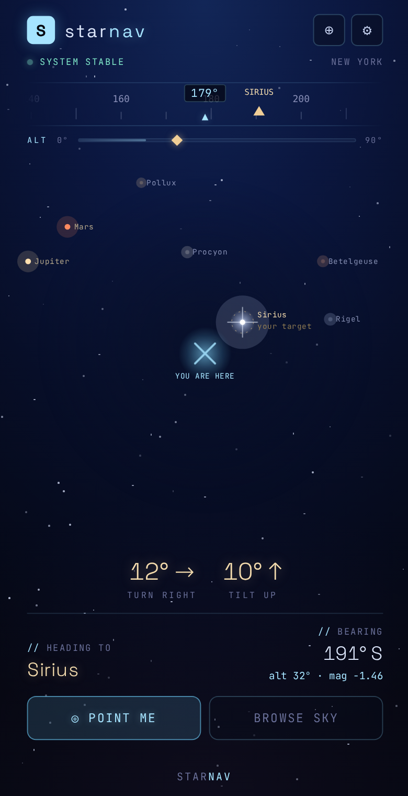
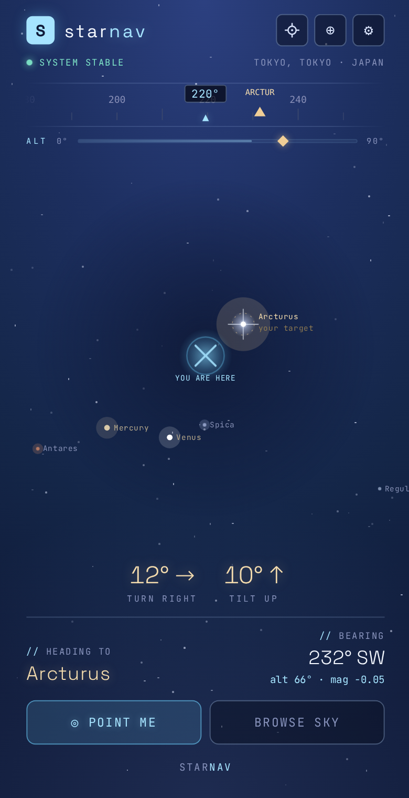

<div align="center">

# 🌌 starnav

### Point your phone at the sky and find out what you're looking at.

$\textcolor{#22d3ee}{\textsf{space}}$ · $\textcolor{#d946ef}{\textsf{time}}$ · $\textcolor{#f5a623}{\textsf{continuum}}$

*No accounts, no sign-up, no ads — and your exact location never leaves your device.*

**▶ Open it — [codereimagine.github.io/starnav](https://codereimagine.github.io/starnav/)**

<sub>The night-sky navigator — in dark and light</sub>
<p>
  
  
</p>

<sub>By <b>Bert Peters</b> · the <b>space</b> axis of <a href="https://github.com/codereimagine">codereimagine</a></sub>

</div>

---

## 🔭 What is it?

starnav is a stargazing guide. Point your phone at the sky — or just browse — and it tells you $\textcolor{#22d3ee}{\textsf{what's up there}}$: the stars, planets and constellations overhead. Pick anything you want to find, and it shows you exactly which way to $\textcolor{#d946ef}{\textsf{turn and tilt}}$ to put it right in front of you.

No app store, no account, nothing to sign up for. Open the link and it works. Like it? Add it to your home screen like any other app.

## ✨ How we do things differently

Most apps want your account, your data, and your attention. Every codereimagine app is built $\textcolor{#d946ef}{\textsf{the other way round}}$:

- **Private by default** — no accounts, no tracking, nothing sold. Your exact location stays on *your* device.
- **No ads, no clutter** — nothing on the screen is trying to sell you something.
- **Yours to keep** — installs like an app and keeps working offline, even on a weak signal.
- **Fully open & free** — the whole thing is public (Apache-2.0). Nothing hidden.
- **Made to feel good** — an everyday tool should be beautiful, not just functional.

## 👀 What you can do with it

- **See what's overhead** — the real positions of the stars, planets and constellations for where you are.
- **Point me there** — pick a target and starnav guides you to it: turn this way, tilt up that much.
- **Find anything** — one search bar for both places and sky objects.
- **Anywhere** — fast on phones and computers.

## 🛠️ Run or build it yourself (developers)

```bash
git clone https://github.com/codereimagine/starnav.git
cd starnav && npm install
npm run dev        # local dev server
npm run build      # production build → dist/
npm run preview    # preview the production build
npm test           # unit tests
```

<details><summary><b>🔧 Under the hood</b></summary>

- **Planets:** JPL/Standish low-precision Keplerian elements (1800–2050), Mercury–Neptune, in `src/engine/planets.ts`.
- **Stars & constellations:** a bright-star catalog + constellation lines baked into the engine (`src/engine/stars.ts`).
- **Coordinate math:** sidereal time and alt-az via NOAA / Meeus formulas in `src/engine/altaz.ts`.
- **Pointing:** `DeviceOrientationEvent` (iOS asks permission first) — a local browser sensor, no network.
- **Location:** an **on/off switch** in Settings (on by default, same as bewthr) and a **target button** in the top bar. Tap it to locate: browser geolocation, **tap-gated** (never prompts on load); if GPS is blocked or never answers, it falls back to an approximate, city-level location from your network via [ipwho.is](https://ipwho.is) — the only location-related request starnav makes (the lookup sees your IP, as any request does). Or search a city by name. GPS coordinates stay on-device, never sent or reverse-geocoded. **Switching location off is the kill switch:** nothing is acquired or sent and a located position is wiped back to the default.
- **City search:** [Open-Meteo geocoding](https://open-meteo.com/en/docs/geocoding-api), keyless — the only outbound call in the whole app, and only when you type it.
- **Design study.**
- **Stack:** React 19 · TypeScript · Vite · `vite-plugin-pwa` · Vitest.

</details>

## 🙌 Credits & thanks

Built with [Claude Code](https://claude.com/claude-code). $\textcolor{#f5a623}{\textsf{Nothing here is hidden}}$ — starnav stands on:

- **Geocoding** — [Open-Meteo](https://open-meteo.com) (CC BY 4.0).
- **Astronomy** — JPL low-precision planetary ephemerides, and coordinate math (sidereal time, alt-az) from NOAA / Jean Meeus's *Astronomical Algorithms*.
- **Fonts** — Space Grotesk & JetBrains Mono (SIL Open Font License 1.1).
- **Emoji** — standard Unicode, drawn by your device.

## 📄 License

Apache-2.0 — see [LICENSE](LICENSE).
